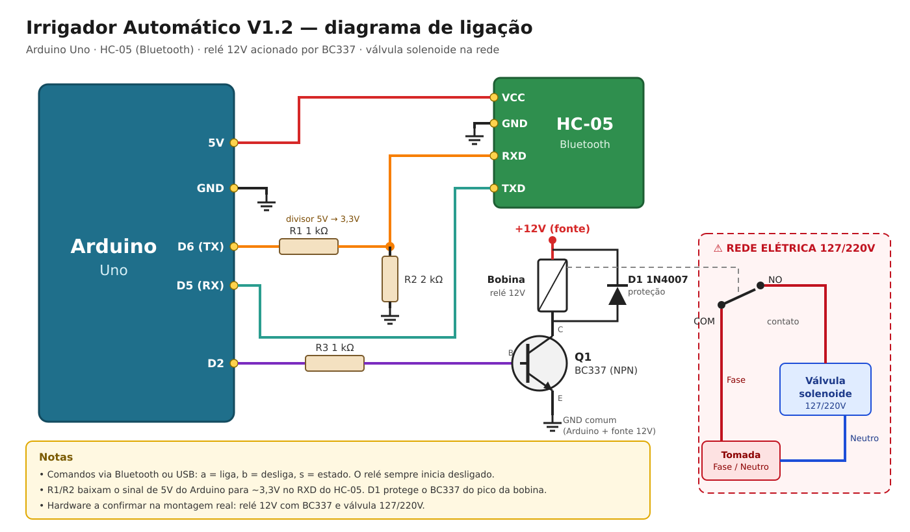

# Automatic Irrigation Controller (Arduino) — work in progress

An Arduino-based irrigation controller: a relay opens and closes a **solenoid valve**, commanded wirelessly over **Bluetooth (HC-05)** or over USB. The project is being built incrementally, one tested version at a time.

It builds on an earlier project I developed at university, a classroom automation controller (projectors and air conditioning over IR, Bluetooth commands, RTC scheduling and watchdog), now in its own repository: [Classroom-Controller](https://github.com/guigaf/Classroom-Controller).



## Status

| Version | What it does | Status |
| --- | --- | --- |
| **V1.0 – Bluetooth communication** | Receives characters from the HC-05 (`SoftwareSerial`, pins 5/6) and echoes them to the serial monitor | Done |
| **V1.1 – Relay command** | Switches the relay on pin 2 from the serial monitor: `a` = on, `b` = off | Done |
| **V1.2 – Bluetooth + relay** | Controls the valve from Bluetooth **or** USB, replies with the current state, always starts with the valve closed | Done – to be tested on hardware |
| V1.3 – Scheduled irrigation | Daily watering schedule with an RTC module | Planned |
| V1.4 – Sensors | Soil-moisture sensor to skip watering when the soil is already wet | Planned |
| V1.5 – Reliability | Watchdog and safe state (valve closed) after a reset | Planned |

## Hardware

| Component | Purpose | Connection |
| --- | --- | --- |
| Arduino Uno | Main controller | — |
| HC-05 Bluetooth module | Wireless commands | TXD → D5 · RXD ← D6 through a 1 kΩ / 2 kΩ divider (5 V → 3.3 V) · VCC 5V · GND |
| BC337 NPN transistor + 1 kΩ base resistor | Drives the relay coil from a 5 V pin | Base ← D2 · emitter → GND |
| 12 V relay + 1N4007 flyback diode | Isolates the mains side from the electronics | Coil between +12 V and the BC337 collector |
| 12 V power supply | Powers the relay coil | GND shared with the Arduino |
| Solenoid valve 127/220 V | Opens/closes the water line | Through the relay COM/NO contact |

The diagram source is [`Placa/wiring-irrigador-v1.2.svg`](Placa/wiring-irrigador-v1.2.svg); the Fritzing sketch of the relay driver is in [`Placa/Rele 12V + BC337/`](Placa/Rele%2012V%20+%20BC337/).

> ⚠️ The valve side runs on mains voltage. Keep it in an insulated enclosure and never work on it while it is plugged in.

## Commands (V1.2)

| Command | Action |
| --- | --- |
| `a` | Turn irrigation on (open the valve) |
| `b` | Turn irrigation off (close the valve) |
| `s` | Report the current state |

Send them from any Bluetooth serial terminal app (HC-05 default PIN `1234` or `0000`, 9600 baud) or from the Arduino IDE serial monitor.

## Repository layout

```
Arduino/Codigos/
├── V1.0 - Comunicaçao Bluetooth/    # Bluetooth link
├── V1.1 - Comando por Rele/         # relay control over USB serial
└── V1.2 - Bluetooth + Rele/         # relay control over Bluetooth or USB
Placa/                               # wiring diagram and Fritzing files
```

## Getting started

1. Install the [Arduino IDE](https://www.arduino.cc/en/software).
2. Wire the circuit as in the diagram above.
3. Open `Arduino/Codigos/V1.2 - Bluetooth + Rele/Bluetooth_Rele/Bluetooth_Rele.ino` and upload it.
4. Pair your phone with the HC-05 and send `a`, `b` or `s`.

No external libraries are needed (`SoftwareSerial` ships with the Arduino IDE).

## Tech

C++ (Arduino) · Bluetooth serial · transistor relay driver · Fritzing
